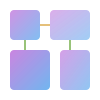

#  Craft

A domain-specific language for modeling business use cases and domain interactions, with automatic generation of C4, domain-flow, and sequence diagrams.

**[Documentation](https://tcarcao.github.io/craft/)** · [Examples](examples/) · [VS Code Extension](https://github.com/tcarcao/craft-vscode-extension)

---

## Install

```bash
brew install tcarcao/craft/craft
```

Verify:

```bash
craft --help
```

## Use as a Go library

Parse Craft source in-process, without shelling out to the CLI:

```bash
go get github.com/tcarcao/craft/v2/pkg/craft
```

```go
import "github.com/tcarcao/craft/v2/pkg/craft"

// Single file.
doc, diags, err := craft.Parse("example.craft", src)

// Multiple files, merged with cross-file resolution.
doc, diags, err := craft.ParseFiles(map[string][]byte{
    "billing.craft": billingSrc,
    "catalog.craft": catalogSrc,
})
```

Diagnostics are returned as data (`diags`); `err` is reserved for programmer
errors. Requires Go 1.25+. The module path carries its major version (`/v2`),
per Go's semantic import versioning.

---

## Quick example

```craft
actors {
    user Customer
    service Database
}

domain Order {
    Cart
    Checkout
    Payment
}

services {
    OrderService {
        contexts: Cart, Checkout, Payment
        data-stores: order_db
        language: golang
        deployment: rolling
    }
}

use_case "Purchase Item" {
    when Customer adds item to cart
        Cart validates item availability
        Cart notifies "Item Added to Cart"

    when Checkout listens "Item Added to Cart"
        Checkout asks Payment to process payment
        Payment notifies "Payment Processed"
}
```

Run `craft validate`, `craft generate`, or `craft inspect` on any `.craft` file. See the [CLI reference](https://tcarcao.github.io/craft/tooling/cli).

---

## Journeys: concurrency, loops, notes, unobserved callers, store hand-offs

A scenario can run steps concurrently with `par`, repeat them with `loop`, and carry `note` and `finding` lines. A `par` without `and` runs each step as its own branch:

```craft
use_case "Seeker reads an advert" {
    finding "nothing caches the resolver answers"
    when Seeker opens an advert
        frontendplatform asks graphql for the advert  [ad]
        par "field resolvers"
            graphql asks atlas for the SEO title  [postSeoadvertsbatch]
            graphql asks atlas for the targeting data  [postAdverttargetingbatch]
        loop "for each image, until all are signed"
            graphql asks media to sign the image URL  [signUrl]
        note "the media service signs one URL per call"
}
```

`when <context> receives …` starts a scenario at a boundary whose caller is not observed (drawn as a found message):

```craft
use_case "Adverts are swept for reindexing" {
    when graphql receives a reindex sweep  [reindexAdverts]
        graphql asks atlas for every advert that needs reindexing  [getAlladvertstoreindex]
}
```

A `store.<name>.<change>` ref is a hand-off through a data store, and a listener can say when it polls:

```craft
invoicing notifies store.sms_queue.inserted
when smsdispatch listens store.sms_queue.inserted cron "* 10 * * 1-5"
```

See [Use Cases](https://tcarcao.github.io/craft/language/use-cases) for the rules and the diagrams.

## Rosters, dynamic publishes, operation lists, streams, egress (2.24)

One handler that serves several events lists them in one `listens` trigger. A trailing comma continues the list:

```craft
use_case "seshat records a Mercury domain event in the transaction ledger" {
    when seshat listens sns.mercury-advert-state-changed, sns.mercury-vas-state-changed,
            sns.mercury-message-received, sns.mercury-cooked
        seshat writes one row per event
}
```

The sequence diagram draws one inbound arrow for the list (`sns.mercury-advert-state-changed, … (+1 more) (from cooker)`). Two scenarios of one use case with the same steps get `craft/lint/duplicate-scenario-body`, which gives the folded trigger.

A step that publishes one event chosen at run time names the set with `notifies one of`:

```craft
        nmf_monetization notifies one of nmfbus.FeatureEnabled, nmfbus.FeatureDisabled,
                nmfbus.CreateAutoSchedule, nmfbus.SubAccountBundleUpdated
```

A comma list in one bracket is one hop that uses several operations:

```craft
        app-manager asks AwsApiGateway to create the key and bind it to the plan  [CreateApiKey, CreateUsagePlanKey]
```

`returns stream` is a reply that repeats; the sequence diagram draws it in a `loop stream` box:

```craft
use_case "Seller asks the assistant a question" {
    when Seller asks the assistant a question
        frontendplatform asks graphql to stream the answer  [assistantStream]
        graphql asks AiAssistant to stream the reply  [POST /api/v1/assistant/chat_streaming]
        AiAssistant returns stream the reply as META, TOKEN and DONE events
        graphql returns stream each event to the client
}
```

`[SQL <tables>]` marks a direct use of another party's tables, `[ADDR <address>]` egress to an address with no operation id (quote an address that starts with `//`), and `inferred` as the first word of a bracket a hop that was not read in code (drawn grey with "(inferred)"):

```craft
        obidoanalytics asks front for the city, region and developer graph  [SQL investment flat city region developer]
        obidoanalytics asks ObjectStore to take the refreshed snapshot     [ADDR "SNAPSHOT_DESTINATION"]
        graphql asks ShaperAgent to initiate the chat                       [inferred POST /api/v1/assistant/initiate_chat]
```

Actors that are not people have their own kinds: `scheduler` (a clock), `tool` (a CLI or client a person runs) and `infra` (platform machinery). They draw as stereotyped boundaries (`<<scheduler>>`), not as persons:

```craft
actors {
    scheduler Ticker
    tool OperatorTool
    infra Pipeline
}
```

A use case's `sites` and `envs` tags appear in its sequence title: `== Rebuild a market's daily statistics [sites: imovirtualpt, otodompl] [envs: production] ==`.

## Surfaces

A `surface` lists the operations a boundary offers, as queries (no side effect) and commands (state change):

```craft
surface concierge {
    callers: Advisor
    spec: "obidozoe/docs/openapi.yaml"
    note "every route takes the shared HTTP Basic pair plus a bidder identity header"
    finding "a read-only credential is refused only at persistence, after the write ran"
    query the seeker list, unpaged, newest first, filtered by a typed status  [getUserList]
    query the seeker audit trail                                             [getUserLogs]
    command delete a seeker's account                                        [deleteAccount]
}
```

`craft generate --type surface` writes a Markdown table whose "Used by" column is computed from the use cases:

| Operation | Kind | What it offers | Used by |
|---|---|---|---|
| `getUserList` | query | the seeker list, unpaged, newest first, filtered by a typed status | Advisor works a task |
| `getUserLogs` | query | the seeker audit trail | — |
| `deleteAccount` | command | delete a seeker's account | Seeker removes their concierge account (unobserved caller) |

`craft validate` warns (`craft/lint/operation-not-in-surface`) when an `asks` names an operation that the target's surface does not list.

---

## VS Code Extension

The [Craft VS Code extension](https://github.com/tcarcao/craft-vscode-extension) adds syntax highlighting, domain/services tree views, and live diagram previews. Install from [GitHub releases](https://github.com/tcarcao/craft-vscode-extension/releases).

---

## Claude Code skill

If you use [Claude Code](https://claude.ai/code), install the Craft skill to get AI assistance for writing and extending `.craft` files:

```bash
npx skills add tcarcao/craft
```

The skill teaches Claude the full grammar, modeling patterns, and event-driven choreography conventions. See the [skill docs](https://tcarcao.github.io/craft/tooling/skill).

---

## Examples

See [examples/](examples/) for complete models:

- **Banking system** — financial services with fraud detection
- **User management** — authentication and profile management

---

## Development

### Prerequisites

- Go 1.22+
- Docker or Podman

### Build

```bash
# First-time setup — pulls ANTLR image and regenerates parser
make fresh-setup

# Build and run the server
make docker-build && make docker-run

# Run tests
make test
```

### Grammar changes

The parser is hand-written: the scanner is in `internal/lexer` and the recursive-descent parser in `internal/syntax`. Language rules are recorded in `docs/decisions/`.

---

## License

MIT
