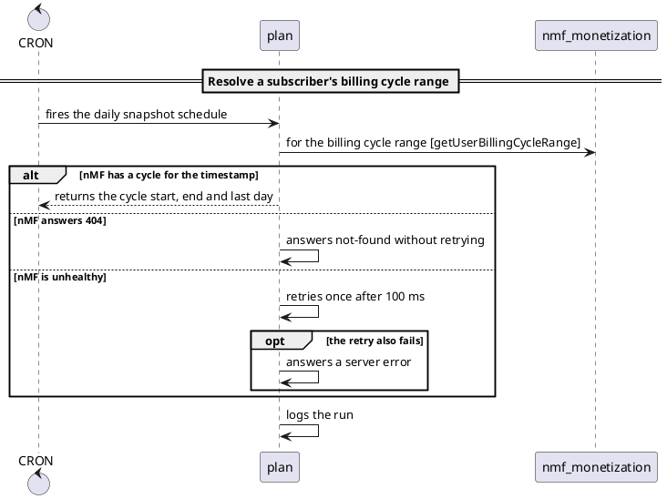

# Use Cases

Use cases model business scenarios through triggers and domain actions. They are the core of Craft's dynamic modeling approach.

## Syntax

```craft
use_case "<name>" {
  when <trigger>
    <action>*

  when <trigger>
    <action>*
}
```

## Basic Example

```craft
use_case "Order Placement" {
  when Customer places order
    Order validates items
    Order creates order record
    Order notifies order.OrderCreated
}
```

::: tip
`order.OrderCreated` is a **typed event ref** — a dotted qualified id. The older quoted-string form (`notifies "Order Created"`) still parses but is deprecated; see [Deprecated: Quoted Event Strings](#deprecated-quoted-event-strings) below.
:::

## Triggers

Triggers define what starts a scenario. There are four types:

### External Triggers

Initiated by actors:

```craft
when user submits registration
when admin approves order
when customer places order
when system sends notification
```

**Syntax:**
```craft
when <actor> <verb> [connector] <phrase>
```

**Connector words** (optional): `a`, `an`, `the`, `to`, `from`, `in`, `on`, `at`, `for`, `with`, `by`

### Event Triggers

Initiated by events:

```craft
when order.OrderPlaced
when auth.UserRegistered
when payment.PaymentProcessed
```

**Syntax:**
```craft
when <event_ref>
```

An `<event_ref>` is a dotted qualified id — the FQ Avro record name / OpenAPI `operationId` the event corresponds to in code. No quotes, no `kind:` prefix, no `/`.

::: tip
Use past tense for event names: `order.OrderPlaced` not `order.PlaceOrder`
:::

### Domain Listener Triggers

Domains reacting to events:

```craft
when Payment listens order.OrderCreated
when Notification listens auth.UserRegistered
when Inventory listens order.OrderCancelled
```

**Syntax:**
```craft
when <domain> listens <event_ref>
```

The trigger context also accepts a **qualified** `<domain>/<name>` reference, e.g. `when re/billing listens vas.VasApplied`, useful when a bare name is ambiguous across domains. A `kind:` prefix (`bc:re/billing`) is not accepted here either.

In a sequence diagram, an event published in another use case arrives from outside the listener's section, labelled with its publishers: `order.OrderCreated (from Ordering)`, at most three names and then `+N more`.

A listener that polls on a schedule says so after the ref, with `cron "<expression>"` or `every "<interval>"` (the same rules as [scheduled triggers](#scheduled-triggers)):

```craft
when smsdispatch listens store.sms_queue.inserted cron "* 10 * * 1-5"
when leadimporter listens sqs.lead-requests every "5m"
```

The model keeps the schedule in `trigger.schedule` and `trigger.scheduleKind`, and the sequence label ends with `, cron * 10 * * 1-5`. This replaces a `polls` tag.

#### Event lists (roster triggers, 2.24)

When one handler serves several events, list them in one trigger instead of writing one scenario per event. A trailing comma continues the list on the next line:

```craft
use_case "seshat records a Mercury domain event in the transaction ledger" {
    when seshat listens sns.mercury-advert-state-changed, sns.mercury-vas-state-changed,
            sns.mercury-message-received, sns.mercury-cooked
        seshat writes one row per event
}
```

- The list means "any of these events starts this scenario". The body is the same for each; when it differs by event, write named scenarios.
- A continuation line is part of the trigger, never a step. `craft fmt` hangs it 8 columns past `when` and never reorders items.
- A schedule (`cron "…"` / `every "…"`) goes after the last item.
- A store ref may not stand in a list of two or more items (`craft/sema/store-ref-in-event-list`): a store hand-off names one store.
- The model keeps every item in `trigger.events`; `trigger.event` stays the first one.

Each item pairs with its publishers on its own. In a sequence diagram, a publisher already in the section delivers its items itself; every other item arrives on **one** inbound arrow per trigger, capped at three items:

```plantuml
[-> seshat : sns.mercury-advert-state-changed, sns.mercury-vas-state-changed, sns.mercury-message-received (+1 more) (from cooker)
```

Flow and architecture views draw one queue edge per item, and C4 one `Event_Queue` delivery per item.

Scenarios of one use case that run the same steps get `craft/lint/duplicate-scenario-body`, once per group of same-body scenarios, at the first of them. When they are `listens` triggers of the same subject (no store ref, same schedule), the message gives one folded trigger with every item of the group: `fold them into one trigger: \`when seshat listens sns.a, sns.b, sns.c\``. When they start differently (another initiator, schedule, `receives` operation or a store hand-off), it names the difference instead.

### Store Hand-offs

When one context writes rows to a table that another context polls, write the hand-off as a **store ref**, `store.<name>.<change>`, where the change is `inserted`, `updated` or `deleted`. There is no new syntax: the writer `notifies` the ref and the reader `listens` to it.

```craft
actors {
    system CRON
    system Siren
}

use_case "Invoicing queues a payment reminder" {
    when cron "0 9 * * 1-5"
        invoicing finds the invoices due in three days
        invoicing notifies store.sms_queue.inserted
}

use_case "The queued reminder is sent" {
    when smsdispatch listens store.sms_queue.inserted cron "* 10 * * 1-5"
        smsdispatch claims the unsent rows
        smsdispatch asks Siren to send the SMS  [sendSmsNotificationEvent]
}
```

A ref is a store ref when it is written bare and its first segment is `store`. The last segment is the change when it is `inserted`, `updated` or `deleted`, and the segments between are the store name (`store.redis.leads.inserted` names `redis.leads`). The name resolves to a service's `data-stores:` entry when one matches. The model sets `action.store` and `trigger.store` (`{name, change, participant}`); `event` and `ref` keep the full text, so publish/listen pairing is unchanged.

Diagrams draw the store as its own participant instead of an event:

```plantuml
boundary "CRON" as CRON
participant "invoicing" as invoicing
database "sms_queue" as sms_queue
participant "smsdispatch" as smsdispatch
boundary "Siren" as Siren

== Invoicing queues a payment reminder ==

CRON -> invoicing : cron 0 9 * * 1-5
invoicing -> invoicing : finds the invoices due in three days
invoicing -> sms_queue : inserted

== The queued reminder is sent ==

smsdispatch -> sms_queue : polls inserted (from invoicing), cron * 10 * * 1-5
smsdispatch -> smsdispatch : claims the unsent rows
smsdispatch -> Siren : to send the SMS [sendSmsNotificationEvent]
```

Mermaid has no database shape in sequence diagrams, so the participant is labelled `sms_queue (store)`. Flow and architecture diagrams draw a database node with writer → store and store → reader edges. C4 never routes a store hand-off through the event queue: when the store is a declared data store and databases are shown (the default; `--no-databases` hides them), it draws `writes <change>` and `polls` relations to the database. Otherwise it draws one `Shared store` relation from each writer to each reader in another container.

`craft/lint/store-without-change` warns about a store ref with no recognised change, and `craft/lint/store-without-name` about a ref such as `store.inserted` that names no store (it is drawn as a plain event).

### Unobserved Callers (`receives`)

Sometimes the code shows that a boundary receives a request, but not who sends it. Name the callee with `receives` instead of inventing a caller:

```craft
use_case "Adverts are swept for reindexing" {
    when graphql receives a reindex sweep  [reindexAdverts]
        graphql asks atlas for every advert that needs reindexing  [getAlladvertstoreindex]
        graphql returns the advert ids
}
```

**Syntax:**
```craft
when <context> receives [connector_word] [phrase] [[operation]]
```

The subject takes the qualified `<domain>/<name>` form. The trigger has `type: "receive"`, and its `operation` holds the bracket. Sequence diagrams draw the UML found message, `[-> graphql : a reindex sweep [reindexAdverts]`, and an unaddressed `returns` becomes a lost message, `graphql -->] : returns the advert ids`. Mermaid has no found message, so it declares a participant `unobserved caller`. Flow diagrams draw an `unobserved caller` node; architecture and C4 draw nothing for it.

`craft/lint/receives-on-actor` warns when the subject is an actor: an actor starts work with `when <Actor> <verb> …`.

::: warning Changed in 2.23
Before 2.23, `when X receives …` was an external trigger with actor `X` and verb `receives`.
:::

### CRON Triggers

Scheduled tasks:

```craft
when CRON runs daily cleanup
when CRON executes hourly sync
```

**Syntax:**
```craft
when CRON [phrase]
```

### Scheduled Triggers

A trigger can carry its schedule: `when cron "<expression>"` for a cron expression, `when every "<interval>"` for a fixed interval.

```craft
actor system CRON

use_case "Weekday Digest" {
    when cron "0 7 * * 1-5"
        Reports builds the daily digest

    scenario "poll"
    when every "5m"
        Feeds polls the upstream feed
}
```

A scheduled trigger runs as the actor `CRON`. Declare `actor system CRON` and it is resolved and counts as used; leave it out and you get the usual undeclared-participant warning. The model keeps the expression in `trigger.schedule` and its form in `trigger.scheduleKind` (`cron` or `every`). Sequence diagrams draw the arrow from `CRON` with the label `cron 0 7 * * 1-5` or `every 5m`.

A cron expression has 5 or 6 space-separated fields, or is one of the macros `@yearly`, `@annually`, `@monthly`, `@weekly`, `@daily`, `@midnight` or `@hourly`. `@every` is not accepted; write an interval as `when every "5m"`. An interval is a positive duration such as `5m` or `1h30m`, or whole days such as `2d`. Anything else is `craft/sema/invalid-schedule`.

## Actions

Actions describe what domains do. There are four types:

### Synchronous Actions

Direct domain-to-domain communication:

```craft
Order asks Inventory to reserve items
Authentication asks Database to verify credentials
Payment asks Gateway for transaction status
```

**Syntax:**
```craft
<domain> asks <domain> [connector] <phrase> [operation]
```

Both the subject and the target accept a **qualified** `<domain>/<name>` reference for disambiguation: `re/subscriptions asks re/billing for a fresh charge attempt`. A bare name like `Inventory` is still the normal short form. A `kind:` prefix is **not** accepted in either slot: `Subscriptions asks bc:re/billing for a fresh charge attempt` is a `craft/syntax/kind-prefix-in-target` parse error. Write `Billing` or `re/billing` instead. See [Node Slugs](/language/overview).

The trailing `<phrase>` still accepts special characters unquoted (`! & * / # ? +`), e.g. `Subscriptions asks Billing for a fresh charge attempt (1! & 2!)`, no need to quote punctuation. The one exception: a bracketed run that closes at the end of the line is now parsed as an **operation annotation**, not prose. See [Operation Annotations](#operation-annotations) below.

**Use when:** One domain needs an immediate response from another.

### Asynchronous Actions

Publish events:

```craft
Order notifies order.OrderCreated
Payment notifies payment.PaymentProcessed
Profile notifies profile.UserUpdated
```

**Syntax:**
```craft
<domain> notifies <event_ref>
```

The subject also accepts a qualified `<domain>/<name>` reference: `re/billing notifies billing.ChargeSucceeded`. A `kind:` prefix is not accepted here either.

**Use when:** Other domains might want to react, but the publisher doesn't need a response.

#### `notifies one of` (2.24)

A step that publishes exactly one event per run, chosen at run time (an event type read from data, a routing table), names the set:

```craft
use_case "nMF republishes a stored money record onto its bus" {
    when nmf_monetization listens stream.user_event_store
        nmf_monetization reads the detail-type off the stored column
        nmf_monetization notifies one of nmfbus.FeatureEnabled, nmfbus.FeatureDisabled,
                nmfbus.CreateAutoSchedule, nmfbus.SubAccountBundleUpdated
}
```

Each item pairs with its listeners. The sequence diagram draws one message, `notifies one of "nmfbus.FeatureEnabled", "nmfbus.FeatureDisabled", "nmfbus.CreateAutoSchedule" (+1 more)`; the flow view draws one edge per item, labelled `one of: <event>`. The model keeps the items in `action.events`.

A bare list, `notifies a.A, b.B`, is an error: to publish several events, write one `notifies` per event. A `notifies` event is one name, so `sync notifies the owners team` is an error too (write an internal step, `sync informs the owners team`). `notifies one of` with a single item gets `craft/lint/one-of-single-event`.

::: tip
`notifies "Order Created"` (quoted string) still parses but is **deprecated** — `craft validate` emits a `craft/lint/deprecated-string-ref` warning and points at the typed-ref form.
:::

### Internal Actions

Domain internal operations:

```craft
Order validates items
Profile creates user record
Authentication generates token
Inventory updates stock levels
```

**Syntax:**
```craft
<domain> <verb> [connector] <phrase>
```

The subject also accepts a qualified `<domain>/<name>` reference: `re/billing validates the event`. A `kind:` prefix is not accepted.

**Use when:** A domain does something internally without calling other domains.

### Return Actions

Return responses:

```craft
Database returns to Authentication the user record
Payment returns confirmation
API returns to Client the error message
Gateway returns to Payment the transaction result
```

**Syntax:**
```craft
<domain> returns [to <domain>] [connector] <phrase>
```

The subject and the `to` target both accept a qualified `<domain>/<name>` reference: `re/subscriptions returns to re/billing charge result`. A `kind:` prefix is not accepted in either slot.

**Use when:** A domain returns data, especially in response to an `asks` action.

#### `returns stream` (2.24)

A reply that repeats until it ends (token streaming, server-sent events) is a `returns stream`. The request stays an ordinary `asks`:

```craft
actors {
    user Seller
    system AiAssistant
}
use_case "Seller asks the assistant a question" {
    when Seller asks the assistant a question
        frontendplatform asks graphql to stream the answer  [assistantStream]
        graphql asks AiAssistant to stream the reply  [POST /api/v1/assistant/chat_streaming]
        AiAssistant returns stream the reply as META, TOKEN and DONE events
        graphql returns stream each event to the client
        frontendplatform appends every TOKEN delta to the message
}
```

The sequence diagram draws each stream in its own box:

```plantuml
loop stream
AiAssistant --> graphql : streams the reply as META, TOKEN and DONE events
end
loop stream
graphql --> frontendplatform : streams each event to the client
end
```

A stream answers the `asks` that opened it, by the same call-stack rule as any return; the model keeps that request's ID in `action.answers`. `returns stream to <reader>` names the reader instead. A stream with no open request and no `to` target gets `craft/lint/stream-without-caller`. The flow view labels the reply `streams …`, and C4 draws a targeted stream between services with the technology `Return Data (stream)`.

## How Names Resolve

Every name in a participant slot (an action's subject, the `asks` or `returns` target, the trigger's actor or listening context) is resolved against the whole model, all files of the folder together. First match wins:

1. a qualified `<domain>/<name>` names that bounded context, or nothing;
2. a bare name declared as a bounded context in exactly one domain;
3. a bare bounded-context name declared in two or more domains is **ambiguous**: it resolves to nothing and `craft/sema/ambiguous-bc` reports it;
4. a domain, then a service, then an actor, then a **data store** declared in some service's `data-stores:`.

A data store is a valid target, so `Authentication asks user_db to check email uniqueness` draws an edge to the service that owns `user_db`. Diagrams, `craft validate` and the language server all use this one order, and `craft check` records the result on each action (`from`, `to`) and trigger (`subject`) as `{kind, id, service}`: `kind` is `bounded_context`, `domain`, `service`, `actor` or `data_store`; `id` is `<domain>/<bc>` for a bounded context; `service` is the service that deploys it.

A bounded context belongs to one service. Listing it in two services' `contexts:` raises `craft/sema/bc-in-multiple-services` (warning), and the first declaration keeps it.

## Branches and Named Scenarios

A scenario is a straight line of steps. Two constructs let it say more: `alt` and `opt` blocks inside a scenario, and an optional `scenario "name"` line before `when`.

```craft
actors {
    service CRON
}

services {
    billing {
        contexts: subscriptions
    }
}

domain subscriptions {
    plan
    nmf_monetization
}

use_case "Resolve a subscriber's billing cycle range" {
    scenario "daily snapshot"
    when CRON fires the daily snapshot schedule
        plan asks nmf_monetization for the billing cycle range  [getUserBillingCycleRange]
        alt "nMF has a cycle for the timestamp"
            plan returns the cycle start, end and last day
        else "nMF answers 404"
            plan answers not-found without retrying
        else "nMF is unhealthy"
            plan retries once after 100 ms
            opt "the retry also fails"
                plan answers a server error
        plan logs the run
}
```

Blocks use the offside rule: a header (`alt`, `else`, `opt`) owns every following line indented deeper than itself. There are no braces and no `end`. `else` must sit at the same column as its `alt`. Labels are required and quoted. `craft fmt` writes the canonical layout.

### When to use which

- **`alt`** for different outcomes of one step: nMF answers OK, 404 or 5xx. Exactly one branch runs. Add one `else` per further outcome.
- **`opt`** for a step, or a few steps, that run only under a condition. It has no `else`.
- **`scenario "name"`** for different ways into the use case: the same use case started by a cron job and by a user. Each way in is its own `when`.

Do not restart a flow from its trigger to describe an outcome. Use `alt` instead; the steps before the branch point stay in the diagram.

### In diagrams

A sequence diagram draws native blocks. The use case above renders as (skinparam lines omitted):



When a use case has several scenarios, each is drawn in a frame titled `<n>: <name>` (or the trigger text when it has no name). A flow diagram prefixes each step in a branch with its label, for example `4. [nMF answers 404] answers not-found without retrying`. When a scenario opens with a block, its trigger reaches every branch: each branch is drawn with its own trigger arrow to that branch's first step. An `opt` can be skipped, so when the opening block is an `opt` the trigger is also drawn outside it, just before the first step after the block.

### Lint

`craft validate` warns with `craft/lint/indistinguishable-scenarios` when two scenarios in one use case have the same trigger text and at least one has no name. Fix it with `alt` if they are outcomes, or with `scenario` names if they are separate entries.

`craft/lint/repeated-request` warns when two different subjects in one step list ask the same target for the same operation, usually two clients (`frontendplatform` and `mobile`) making one request. Write it once with a `channels` tag, or open the scenario with `alt "on the web"` / `else "in the app"`. A call chain (the second subject was asked earlier in the list and relays the request) is not reported.

`scenario`, `alt`, `opt` and `else` stay valid names for actors and contexts. They are keywords only at the start of a line and only before a quoted label. Syntax errors for blocks are listed in the [diagnostics codebook](https://github.com/tcarcao/craft/blob/main/docs/DIAGNOSTICS.md).

## Concurrent and Repeated Steps

`par` runs steps concurrently, and `loop` repeats them. Both use the offside rule of `alt`/`opt`, and every block kind nests inside every other.

```craft
use_case "Seeker reads an advert" {
    when Seeker opens an advert
        frontendplatform asks graphql for the advert  [ad]
        par "field resolvers"
            graphql asks atlas for the SEO title  [postSeoadvertsbatch]
            graphql asks atlas for the targeting data  [postAdverttargetingbatch]
            graphql asks atlas where the advert came from  [postAdsourcebatch]
        loop "for each image, until all are signed"
            graphql asks media to sign the image URL  [signUrl]
}
```

A `par` without `and` is the **fan-out form**: each step of its body (an action or a nested block) is its own concurrent branch. That is the usual case, one caller issuing several independent requests. When a branch has several steps in sequence, give each branch a header with `and`, at the column of its `par`:

```craft
        par "the advert"
            graphql asks adcore for the advert  [GET /ads]
            graphql asks atlas for the owner  [getAdsMappings]
        and "the statistics"
            graphql asks Dapi for the page statistics  [GET /projects/{site}_ad_statistics]
```

`loop "<condition>"` has one branch, like `opt`. Its label is the condition or the iteration ("for each owner", "until ten polls"). Diagrams draw one iteration.

In the model, `block.kind` is `par` or `loop`; a fan-out `par` has `split: true` and one branch per step, each carrying the header's label. Sequence diagrams draw native `par` and `loop` frames (PlantUML separates branches with `else`, Mermaid with `and`). Flow diagrams prefix each step with the block, for example `3. [par: field resolvers] for the SEO title`.

An `else` cannot continue a `par` or a `loop` (`craft/syntax/orphan-else`), and an `and` cannot continue an `alt`, `opt` or `loop` (`craft/syntax/orphan-and`). `craft/lint/single-branch-par` warns about a `par` with only one step, where nothing runs concurrently.

## Notes and Findings

A `note` records a fact about the flow that is not a step; a `finding` records a defect or a risk the author found:

```craft
use_case "Seller pays an invoice" {
    finding "nothing retries a failed callback; a lost callback leaves the invoice open"
    when Seller pays an invoice
        frontendplatform asks graphql to pay  [payInvoice]
        note "the gateway forwards the seller's session, not a service token"
        graphql asks paymentgateway to start the payment  [POST /payments]
        finding "no idempotency key: a client retry starts a second payment"
}
```

A note is one line: the keyword and one quoted text. Write several notes for more. It can stand wherever a step can, or at use-case level after `tags { }` and before the first `scenario`/`when`. A note is not an action: it gets no interaction and does not count as a step. A branch that holds only a note is not empty.

Sequence diagrams draw a note over the participants of the message before it (across the diagram when there is none). A finding is prefixed `Finding: ` and, in PlantUML, coloured:

```plantuml
note over Seller, paymentgateway #FFE4E1 : Finding: nothing retries a failed callback; a lost callback leaves the invoice open
Seller -> frontendplatform : pays an invoice
frontendplatform -> graphql : to pay [payInvoice]
note over frontendplatform, graphql : the gateway forwards the seller's session, not a service token
graphql -> paymentgateway : to start the payment [POST /payments]
note over graphql, paymentgateway #FFE4E1 : Finding: no idempotency key: a client retry starts a second payment
```

The model keeps step notes as `step.note` and use-case-level notes in `useCase.notes`, each `{kind, text}` with `kind` `note` or `finding`. Flow, architecture and C4 diagrams do not draw notes.

`par`, `and`, `loop`, `note`, `finding` and `receives` stay valid names, like `alt` and `opt`: each is a keyword only in its own position.

## Operation Annotations

Any action (`asks`, `notifies`, `returns`, or an internal action) may end with a bracketed **operation annotation** describing the actual wire call it corresponds to:

```craft
Subscriptions asks Billing for a fresh charge attempt  [POST /v1/accounts/{id}/charges]
Billing asks Ledger to record the entry                [GRPC ledger.Postings/Create]
Billing notifies billing.ChargeSucceeded                [TOPIC billing.v1.charge-succeeded]
Subscriptions asks Audit to log the outcome            [op1/op2/op3]
Subscriptions asks Legacy for a reconciliation          [legacy-mainframe-txn-44]
```

**Syntax:**
```craft
<action> [<protocol_verb> <payload>]
<action> [<payload>]
```

The bracket is optional; lines without one are unaffected. Its contents are **hybrid**:

- If the first whitespace-delimited token is a recognised protocol verb, the annotation is parsed as structure: a verb plus the remaining payload. The recognised set is `GET`, `POST`, `PUT`, `PATCH`, `DELETE`, `HEAD`, `OPTIONS`, `GRPC`, `TOPIC`, `QUERY`, and (2.24) `ADDR` and `SQL`.
- Otherwise, the entire bracket content is stored verbatim as an opaque payload, with no diagnostic. `[op1/op2/op3]` and `[legacy-mainframe-txn-44]` are equally valid annotations: an unrecognised leading word is payload, not an error.

**Boundary rule:** the annotation is the **last** `[` on the line whose matching `]` is the line's final token. A `[` that does not close at the end of the line stays ordinary prose, so existing phrases are unaffected unless they end in a bracketed run.

An empty annotation, `Subscriptions asks Billing for a fresh charge attempt []`, is a `craft/syntax/empty-op-annotation` error, not a silently dropped bracket.

### Operation lists (2.24)

One hop that uses several operations lists them in one bracket:

```craft
app-manager asks AwsApiGateway to create the key and bind it to the plan  [CreateApiKey, CreateUsagePlanKey]
Partner asks ad/atlas-advert to save or delete the advert  [postAdvert, putAdvert, deleteAdvert]
```

- The bracket splits at a comma followed by whitespace, outside braces and strings: `[GET /nearest/paths/{latitude},{longitude}]` stays one item.
- Each item is read like a whole bracket: an optional protocol verb, then the payload.
- Craft does not say whether the items are alternatives or a sequence. Say which in the phrase ("to save or delete"). Two hops to two parties are two `asks`.
- A route and the client method that calls it are not two operations: put the route in the bracket.
- An empty item (`[a, , b]`) is `craft/syntax/empty-op-annotation`; a repeated item is `craft/lint/duplicate-operation-in-list`. `craft/lint/operation-not-in-surface` checks each item.
- The model keeps every item in `action.operations`. `action.operation` keeps the whole bracket, as before.

### Egress and inferred hops: `SQL`, `ADDR`, `inferred` (2.24)

```craft
actors {
    system CRON
    system ObjectStore
}
use_case "obido analytics refreshes the market structure" {
    when cron "0 18 * * *"
        obidoanalytics asks front for the city, region and developer graph  [SQL investment flat city region developer]
        obidoanalytics asks ObjectStore to take the refreshed snapshot  [ADDR "SNAPSHOT_DESTINATION"]
}
```

- **`[SQL <table> …]`**: a direct read or write of another party's tables, with no API between. The payload is the table names, separated by spaces.
- **`[ADDR <address>]`**: egress to an address that has no operation id (a URL, a host, or the name of the setting that holds it). The label prints the address without quotes. **Quote an address that starts with `//`**: a `//` after a space starts a comment, which cuts the bracket (`craft/lint/unquoted-address`). Quoting is always allowed.
- Both verbs need a payload (`[ADDR]` and `[SQL]` are `craft/syntax/empty-op-annotation`), and both name a call to another party, so write them on an `asks`: on an internal step or a return they get `craft/lint/egress-on-internal-step`.
- C4 names the technology: `SQL (shared tables)` for a `SQL` request between services, and `HTTP (bare address)` for an `ADDR` request. An `ADDR` request to an actor is drawn as a relation to that actor, shown as an external system.

`inferred` as the first word of a bracket marks a hop that was inferred from names, configuration or convention, not read in code:

```craft
graphql asks ShaperAgent to initiate the chat  [inferred POST /api/v1/assistant/initiate_chat]
```

It applies to the whole action. `[inferred]` alone says the hop is inferred and its operation unknown. The sequence diagram draws it grey with a suffix, `graphql -[#999999]> ShaperAgent : to initiate the chat [POST /api/v1/assistant/initiate_chat] (inferred)` (Mermaid has no per-arrow colour and prints the suffix only); flow and C4 labels gain ` (inferred)` too. In a `receives` trigger or a surface line, `inferred` is an ordinary payload word.

::: warning Braces in a phrase disable the annotation on that line
A balanced `{...}` in the phrase and a trailing annotation cannot both appear on one line:

```craft
Billing asks Gateway to charge {amount} [POST /pay]
```

parses with a phrase of `charge {amount` and reports the rest, rather than as an annotated action. The annotation scan and the phrase scan have to agree on where the line ends, and the phrase scan stops at the first `}`. Move the `{...}` out of the phrase, or drop the annotation from that line.

Braces **inside** the annotation are unaffected, which is the case that matters for templated paths: `[POST /v1/accounts/{id}/charges]` and `[GET /v1/products?q={term}]` both parse correctly.
:::

**Formatting.** `craft fmt <files...>` formats in place and column-aligns operation annotations and trailing `//` comments, each into its own column per contiguous run within a scenario. A non-annotated (or non-commented) action inside a run does not reset it. A blank line or a new scenario does. Alignment is cosmetic; the grammar itself stays whitespace-insensitive.

`craft fmt --check <files...>` writes nothing, lists every file that is not already formatted, and exits non-zero, which is the shape a CI gate wants. Arguments are paths or glob patterns including `**`; directories are not walked, so pass `'**/*.craft'` to cover a tree. A file the parser cannot fully place is never rewritten, and is reported as skipped with the diagnostic that blocked it.

Formatting canonicalises layout only: 4-space indentation by default (configurable via a `.craftfmt` file or the `--indent` flag), one statement per line, and a blank line between top-level declarations. Nothing inside a statement is respaced, so a phrase like `(1! & 2!)` and a qualified ref like `billing/Invoice` come back exactly as written. Every `.craft` file in the Craft repository is checked on every build to confirm formatting is reparse-clean, idempotent, model-preserving, and comment-preserving.

**Go library API.** `pkg/craft`, the stable public Go API, exposes the annotation as `craft.Operation` (`Verb`, `Payload`, `Text` fields), the recognised verbs as the `craft.OpVerbGET` through `craft.OpVerbQUERY` constants, and `craft.ProtocolVerbs()` returning the same set as a `[]string`.

## Tags

A `use_case` may open with a `tags { }` block: free-form `key: value` metadata carried through to the model and out of `craft check`, for whatever a downstream tool wants to do with it (grouping, filtering, linking to a ticket).

```craft
use_case "Settle a seller invoice" {
  tags {
    journey: re/renewal-flow
    channels: "web, mobile"
    owner: billing-team
  }

  when Seller opens the payments page
    Invoicing charges the card
}
```

A value is a **comma-separated list of one or more items**, the same shape a service block's `contexts:` uses. Each item is either of:

- **A bare item**, which may contain slashes and hyphens, so `re/renewal-flow` is one item rather than three. This is the form for a slug or a qualified reference.
- **A quoted string**, which may contain anything, including spaces and commas.

The two mix freely within one list, and a list may wrap across lines:

```craft
tags {
  channels: web, mobile
  surfaces: "web app", re/tablet-web
  regions: eu,
  us,
  apac
}
```

The block goes before the first `when`. Keys are not interpreted by Craft, except `sites` and `envs` (below). A repeated key is last-write-wins and emits `craft/sema/duplicate-tag`.

**`sites` and `envs` (2.24).** These two keys say on which sites or environments the whole use case runs. The sequence diagram appends them to the section title, each part only when its tag is present, values in authored order:

```plantuml
== Rebuild a market's daily statistics [sites: imovirtualpt, otodompl, storiaro] [envs: production] ==
```

Use a tag when the whole use case is scoped; use `opt "…"` when one step runs only on some sites, and `alt "…"` or named scenarios when the steps differ. Craft does not check the values; the hub does.

### Tags in `craft check` output

Each tag appears twice, because one string cannot represent a list without ambiguity:

- **`tags`** carries the value joined with `, `. This is the original single-valued field, unchanged, so anything already reading it keeps working.
- **`tagValues`** carries the items unjoined, one entry per authored item. Single-valued tags appear here too, as a one-item list, so you can read this field uniformly.

```json
{
  "tags":      { "channels": "web, mobile", "note": "one, value" },
  "tagValues": { "channels": ["web", "mobile"], "note": ["one, value"] }
}
```

Those two inputs were `channels: web, mobile` and `note: "one, value"`. They are identical in `tags` and distinct in `tagValues`, which is the reason the second field exists: **quote an item to keep a comma inside it.**

::: warning A comma needs a value after it
`channels: web,` with nothing following is an error, and so is a comma followed by the next tag key. The whole statement is rejected in that case and the tag does not reach the model at all, rather than silently reporting a truncated list or taking the next key as a value.
:::

## Diagnostics

Use-case actions and triggers can emit these:

| Code | Severity | When |
|------|----------|------|
| `craft/syntax/kind-prefix-in-target` | error | a `kind:` prefix (`bc:`, `domain:`, `service:`, `term:`) is written in a bounded-context slot: the subject of any action (`asks`, `notifies`, `returns`, or an internal action), the `asks` target, the `returns` target, or the `when ... listens` trigger context. Write `Billing` or `re/billing` instead. |
| `craft/syntax/empty-op-annotation` | error | an action ends in `[]`, an empty operation annotation. |
| `craft/sema/ambiguous-bc` | error | a bare bounded-context name is declared in two or more domains, in any participant slot: any action's subject, the `asks` or `returns` target, or the trigger's actor or listening context. Qualify it as `<domain>/<name>`. |
| `craft/sema/malformed-slug` | error | a qualified `<domain>/<name>` reference has the wrong shape (an empty segment like `re/ billing` or `re//billing`, or more than two segments like `re/a/b`) in any bounded-context slot: any action's subject, the `asks` target, the `returns` target, or the trigger context. |
| `craft/sema/duplicate-tag` | warning | the same tag key is set twice in one `use_case`. The last value wins. |
| `craft/syntax/orphan-and` | error | an `and` has no open `par` at its column. |
| `craft/syntax/missing-label` | error | a block header (`alt`, `opt`, `else`, `par`, `and`, `loop`) has no quoted label, or a `note`/`finding` has no quoted text. |
| `craft/lint/single-branch-par` | warning | a `par` without `and` has only one step, so nothing runs concurrently. |
| `craft/lint/receives-on-actor` | warning | the subject of a `receives` trigger is an actor. |
| `craft/lint/store-without-change` | warning | a store ref does not end in `inserted`, `updated` or `deleted`. |
| `craft/lint/store-without-name` | warning | a ref starts with `store.` but names no store. |
| `craft/lint/repeated-request` | warning | two subjects in one step list make the same request to the same target. |
| `craft/lint/operation-not-in-surface` | warning | an `asks` names an operation that the target's [surface](#surfaces) does not list (each item of an operation list is checked). |
| `craft/syntax/empty-op-annotation` (2.24) | error | also an empty item of an operation list (`[a, , b]`), or `[ADDR]`/`[SQL]` with no payload. |
| `craft/syntax/unexpected-token` (2.24) | error | also a comma with no event after it in a `listens` or `notifies one of` list, a bare list after `notifies`, or words after a `notifies` event. |
| `craft/sema/store-ref-in-event-list` | error | a store ref in a `listens` or `notifies one of` list of two or more items. |
| `craft/lint/duplicate-event-in-list` | warning | the same event twice in one list. |
| `craft/lint/duplicate-operation-in-list` | warning | the same operation twice in one bracket. |
| `craft/lint/duplicate-scenario-body` | warning | two scenarios of one use case run the same steps. |
| `craft/lint/one-of-single-event` | warning | `notifies one of` names a single event. |
| `craft/lint/stream-without-caller` | warning | a `returns stream` answers no open request and names no reader. |
| `craft/lint/egress-on-internal-step` | warning | an internal step or a return has an `ADDR` or `SQL` item. |
| `craft/lint/unquoted-address` | warning | a `//` comment cut an `[ADDR …]` bracket. |

## Surfaces

A `surface` lists the operations one boundary offers, whether or not a use case calls them. The boundary is a bounded context, a service, or an actor that stands for an external system.

```craft
surface concierge {
    callers: Advisor
    spec: "obidozoe/docs/openapi.yaml"
    note "every route takes the shared HTTP Basic pair plus a bidder identity header"
    finding "a read-only credential is refused only at persistence, after the write ran"
    query the seeker list, unpaged, newest first, filtered by a typed status  [getUserList]
    query the seeker audit trail                                             [getUserLogs]
    command delete a seeker's account                                        [deleteAccount]
}
```

- `query` marks an operation with no side effect, `command` one that changes state. The line reads like an action without a subject: a phrase that says what the operation offers, then the required `[operation]`.
- `callers:` lists who calls the boundary: actors, contexts or services. `unknown` means no caller was observed, and it can stand next to named callers.
- `spec:` points at the API specification. Craft keeps it verbatim and does not read the file.
- `note` and `finding` hold facts that apply to the whole surface.

`craft generate --type surface` writes `<base>-surface.md` (`--stdout` works too). The "Used by" column is computed: an operation is used by every use case with an `asks` to the boundary and the same operation text, and by a `receives` trigger on the boundary with that operation, marked `(unobserved caller)`. A surface on a service also covers the bounded contexts it deploys that have no surface of their own.

```markdown
# Surfaces

## concierge

Callers: Advisor
Spec: `obidozoe/docs/openapi.yaml`

> every route takes the shared HTTP Basic pair plus a bidder identity header

> **Finding:** a read-only credential is refused only at persistence, after the write ran

| Operation | Kind | What it offers | Used by |
|---|---|---|---|
| `getUserList` | query | the seeker list, unpaged, newest first, filtered by a typed status | Advisor works a task |
| `getUserLogs` | query | the seeker audit trail | — |
| `deleteAccount` | command | delete a seeker's account | Seeker removes their concierge account (unobserved caller) |
```

`--type all` writes the surface file only when the model declares a surface; overwriting an existing `.md` needs `--force`. Sequence, flow, architecture and C4 diagrams ignore surfaces.

| Code | Severity | When |
|------|----------|------|
| `craft/syntax/missing-operation` | error | a `query`/`command` line has no `[operation]`. The line is dropped. |
| `craft/syntax/missing-phrase` | error | a `query`/`command` line has its `[operation]` but no phrase before it. |
| `craft/syntax/unclosed-block` | error | the surface has no `}`. |
| `craft/sema/unresolved-reference` | error | the subject, or a `callers:` entry other than `unknown`, does not resolve. |
| `craft/sema/invalid-surface-subject` | error | the subject is a domain or a data store. |
| `craft/sema/duplicate-name` | error / warning | a second surface for the same subject; the first one in sorted file order is used. |
| `craft/sema/duplicate-operation` | error | the same operation appears twice in one surface. |
| `craft/lint/operation-not-in-surface` | warning | an `asks <target> … [op]` names an operation that the target's surface does not list. |

## Deprecated: Quoted Event Strings

Older `.craft` files (and older docs) write event names as quoted strings:

```craft
Order notifies "Order Created"
when Payment listens "Order Created"
```

This form still **parses** — `craft validate` won't reject it — but it's **deprecated**: every quoted event string emits a `craft/lint/deprecated-string-ref` warning pointing at the typed-ref replacement. Prefer the typed-ref form (`notifies order.OrderCreated`) in all new or extended files; only leave quoted strings where you're intentionally not migrating an existing file.

## Complete Example

```craft
use_case "Order Processing" {
  // External trigger: customer action
  when Customer places order
    Order validates product availability
    Order asks Inventory to reserve items
    Order calculates total amount
    Order asks Payment to create payment request
    Order notifies order.OrderCreated

  // Domain listener: Payment reacts to Order Created
  when Payment listens order.OrderCreated
    Payment asks PaymentGateway to process transaction
    PaymentGateway returns to Payment the transaction result
    Payment updates payment status
    Payment notifies payment.PaymentProcessed

  // Domain listener: Notification reacts to Payment
  when Notification listens payment.PaymentProcessed
    Notification asks EmailService to send confirmation
    Notification asks SMSService to send notification

  // Domain listener: Inventory reacts to Payment
  when Inventory listens payment.PaymentProcessed
    Inventory confirms reservation
    Inventory updates stock levels
}
```

## Event-Driven Pattern

```craft
use_case "User Registration" {
  when user submits registration
    Authentication validates email format
    Authentication asks Database to check uniqueness
    Profile creates initial profile
    Authentication notifies auth.UserRegistered

  when Profile listens auth.UserRegistered
    Profile asks Database to store profile
    Profile notifies profile.ProfileCreated

  when Notification listens auth.UserRegistered
    Notification asks EmailService to send welcome email

  when Analytics listens auth.UserRegistered
    Analytics records registration event
    Analytics updates metrics
}
```

## Request-Response Pattern

```craft
use_case "Get User Profile" {
  when Customer requests profile
    API validates authentication token
    API asks Profile for user data
    Profile asks Database to fetch profile
    Database returns to Profile the profile data
    Profile returns to API the formatted profile
    API returns to Customer the profile
}
```

## Error Handling Pattern

```craft
use_case "Process Payment" {
  when Customer submits payment
    Payment validates payment details
    Payment asks Gateway to charge card
    Gateway returns to Payment the transaction result

  when Payment listens payment.TransactionFailed
    Payment creates retry attempt
    Payment notifies payment.PaymentFailed

  when Order listens payment.PaymentFailed
    Order cancels order
    Order asks Inventory to release reservation
    Order notifies order.OrderCancelled
}
```

## Best Practices

### Use Past Tense for Events

✅ Good:
```craft
Order notifies order.OrderCreated
Payment notifies payment.PaymentProcessed
```

❌ Bad:
```craft
Order notifies order.CreateOrder
Payment notifies payment.ProcessPayment
```

### Be Specific with Actions

✅ Good:
```craft
Authentication validates email format
Order calculates total amount
```

❌ Bad:
```craft
Authentication validates
Order calculates
```

### Use Domain Names, Not Service Names

✅ Good:
```craft
Order asks Inventory to reserve items
```

❌ Bad:
```craft
OrderService asks InventoryService to reserve items
```

### Keep Scenarios Focused

Each `when` block should represent a cohesive scenario.

✅ Good:
```craft
use_case "Order Processing" {
  when Customer places order
    // 5-10 related actions

  when Payment listens order.OrderCreated
    // 3-5 related actions
}
```

❌ Bad:
```craft
use_case "Everything" {
  when Customer places order
    // 50+ unrelated actions
}
```

## Common Patterns

### Saga Pattern

```craft
use_case "Distributed Transaction" {
  when user initiates order
    Order creates order
    Order notifies order.OrderStarted

  when Payment listens order.OrderStarted
    Payment charges customer
    Payment notifies payment.PaymentCompleted

  when Inventory listens payment.PaymentCompleted
    Inventory ships items
    Inventory notifies inventory.ShipmentSent

  when Order listens payment.PaymentFailed
    Order cancels order
    Order notifies order.OrderCancelled
}
```

### CQRS Pattern

```craft
use_case "Order Management" {
  // Command side
  when user creates order
    OrderCommand validates order
    OrderCommand stores order
    OrderCommand notifies order.OrderCreated

  // Query side
  when OrderQuery listens order.OrderCreated
    OrderQuery updates read model
    OrderQuery indexes order data
}
```

## Next Steps

- See [complete examples](/examples/ecommerce) with multiple use cases
- Learn about [services](/language/services) to organize domains
- Understand [domains](/language/domains) to structure your model
