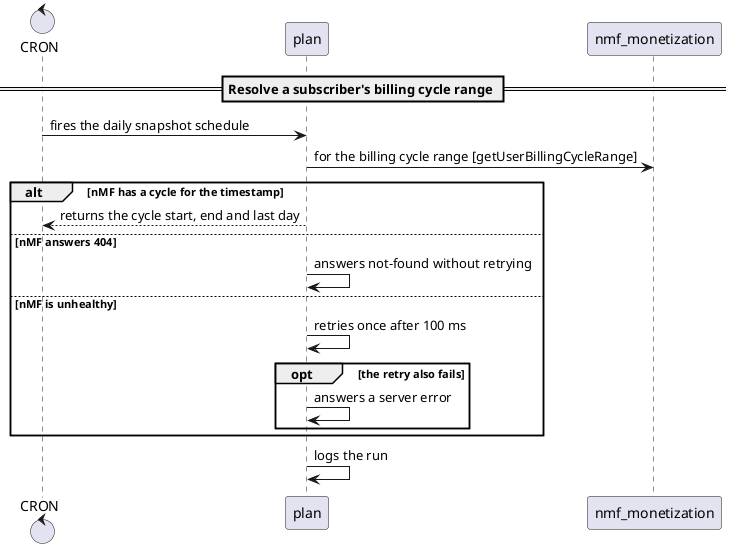

# Use Cases

Use cases model business scenarios through triggers and domain actions. They are the core of Craft's dynamic modeling approach.

## Syntax

```craft
use_case "<name>" {
  when <trigger>
    <action>*

  when <trigger>
    <action>*
}
```

## Basic Example

```craft
use_case "Order Placement" {
  when Customer places order
    Order validates items
    Order creates order record
    Order notifies order.OrderCreated
}
```

::: tip
`order.OrderCreated` is a **typed event ref** — a dotted qualified id. The older quoted-string form (`notifies "Order Created"`) still parses but is deprecated; see [Deprecated: Quoted Event Strings](#deprecated-quoted-event-strings) below.
:::

## Triggers

Triggers define what starts a scenario. There are four types:

### External Triggers

Initiated by actors:

```craft
when user submits registration
when admin approves order
when customer places order
when system sends notification
```

**Syntax:**
```craft
when <actor> <verb> [connector] <phrase>
```

**Connector words** (optional): `a`, `an`, `the`, `to`, `from`, `in`, `on`, `at`, `for`, `with`, `by`

### Event Triggers

Initiated by events:

```craft
when order.OrderPlaced
when auth.UserRegistered
when payment.PaymentProcessed
```

**Syntax:**
```craft
when <event_ref>
```

An `<event_ref>` is a dotted qualified id — the FQ Avro record name / OpenAPI `operationId` the event corresponds to in code. No quotes, no `kind:` prefix, no `/`.

::: tip
Use past tense for event names: `order.OrderPlaced` not `order.PlaceOrder`
:::

### Domain Listener Triggers

Domains reacting to events:

```craft
when Payment listens order.OrderCreated
when Notification listens auth.UserRegistered
when Inventory listens order.OrderCancelled
```

**Syntax:**
```craft
when <domain> listens <event_ref>
```

The trigger context also accepts a **qualified** `<domain>/<name>` reference, e.g. `when re/billing listens vas.VasApplied`, useful when a bare name is ambiguous across domains. A `kind:` prefix (`bc:re/billing`) is not accepted here either.

In a sequence diagram, an event published in another use case arrives from outside the listener's section, labelled with its publishers: `order.OrderCreated (from Ordering)`, at most three names and then `+N more`.

### CRON Triggers

Scheduled tasks:

```craft
when CRON runs daily cleanup
when CRON executes hourly sync
```

**Syntax:**
```craft
when CRON [phrase]
```

### Scheduled Triggers

A trigger can carry its schedule: `when cron "<expression>"` for a cron expression, `when every "<interval>"` for a fixed interval.

```craft
actor system CRON

use_case "Weekday Digest" {
    when cron "0 7 * * 1-5"
        Reports builds the daily digest

    scenario "poll"
    when every "5m"
        Feeds polls the upstream feed
}
```

A scheduled trigger runs as the actor `CRON`. Declare `actor system CRON` and it is resolved and counts as used; leave it out and you get the usual undeclared-participant warning. The model keeps the expression in `trigger.schedule` and its form in `trigger.scheduleKind` (`cron` or `every`). Sequence diagrams draw the arrow from `CRON` with the label `cron 0 7 * * 1-5` or `every 5m`.

A cron expression has 5 or 6 space-separated fields, or is one of the macros `@yearly`, `@annually`, `@monthly`, `@weekly`, `@daily`, `@midnight` or `@hourly`. `@every` is not accepted; write an interval as `when every "5m"`. An interval is a positive duration such as `5m` or `1h30m`, or whole days such as `2d`. Anything else is `craft/sema/invalid-schedule`.

## Actions

Actions describe what domains do. There are four types:

### Synchronous Actions

Direct domain-to-domain communication:

```craft
Order asks Inventory to reserve items
Authentication asks Database to verify credentials
Payment asks Gateway for transaction status
```

**Syntax:**
```craft
<domain> asks <domain> [connector] <phrase> [operation]
```

Both the subject and the target accept a **qualified** `<domain>/<name>` reference for disambiguation: `re/subscriptions asks re/billing for a fresh charge attempt`. A bare name like `Inventory` is still the normal short form. A `kind:` prefix is **not** accepted in either slot: `Subscriptions asks bc:re/billing for a fresh charge attempt` is a `craft/syntax/kind-prefix-in-target` parse error. Write `Billing` or `re/billing` instead. See [Node Slugs](/language/overview).

The trailing `<phrase>` still accepts special characters unquoted (`! & * / # ? +`), e.g. `Subscriptions asks Billing for a fresh charge attempt (1! & 2!)`, no need to quote punctuation. The one exception: a bracketed run that closes at the end of the line is now parsed as an **operation annotation**, not prose. See [Operation Annotations](#operation-annotations) below.

**Use when:** One domain needs an immediate response from another.

### Asynchronous Actions

Publish events:

```craft
Order notifies order.OrderCreated
Payment notifies payment.PaymentProcessed
Profile notifies profile.UserUpdated
```

**Syntax:**
```craft
<domain> notifies <event_ref>
```

The subject also accepts a qualified `<domain>/<name>` reference: `re/billing notifies billing.ChargeSucceeded`. A `kind:` prefix is not accepted here either.

**Use when:** Other domains might want to react, but the publisher doesn't need a response.

::: tip
`notifies "Order Created"` (quoted string) still parses but is **deprecated** — `craft validate` emits a `craft/lint/deprecated-string-ref` warning and points at the typed-ref form.
:::

### Internal Actions

Domain internal operations:

```craft
Order validates items
Profile creates user record
Authentication generates token
Inventory updates stock levels
```

**Syntax:**
```craft
<domain> <verb> [connector] <phrase>
```

The subject also accepts a qualified `<domain>/<name>` reference: `re/billing validates the event`. A `kind:` prefix is not accepted.

**Use when:** A domain does something internally without calling other domains.

### Return Actions

Return responses:

```craft
Database returns to Authentication the user record
Payment returns confirmation
API returns to Client the error message
Gateway returns to Payment the transaction result
```

**Syntax:**
```craft
<domain> returns [to <domain>] [connector] <phrase>
```

The subject and the `to` target both accept a qualified `<domain>/<name>` reference: `re/subscriptions returns to re/billing charge result`. A `kind:` prefix is not accepted in either slot.

**Use when:** A domain returns data, especially in response to an `asks` action.

## How Names Resolve

Every name in a participant slot (an action's subject, the `asks` or `returns` target, the trigger's actor or listening context) is resolved against the whole model, all files of the folder together. First match wins:

1. a qualified `<domain>/<name>` names that bounded context, or nothing;
2. a bare name declared as a bounded context in exactly one domain;
3. a bare bounded-context name declared in two or more domains is **ambiguous**: it resolves to nothing and `craft/sema/ambiguous-bc` reports it;
4. a domain, then a service, then an actor, then a **data store** declared in some service's `data-stores:`.

A data store is a valid target, so `Authentication asks user_db to check email uniqueness` draws an edge to the service that owns `user_db`. Diagrams, `craft validate` and the language server all use this one order, and `craft check` records the result on each action (`from`, `to`) and trigger (`subject`) as `{kind, id, service}`: `kind` is `bounded_context`, `domain`, `service`, `actor` or `data_store`; `id` is `<domain>/<bc>` for a bounded context; `service` is the service that deploys it.

A bounded context belongs to one service. Listing it in two services' `contexts:` raises `craft/sema/bc-in-multiple-services` (warning), and the first declaration keeps it.

## Branches and Named Scenarios

A scenario is a straight line of steps. Two constructs let it say more: `alt` and `opt` blocks inside a scenario, and an optional `scenario "name"` line before `when`.

```craft
actors {
    service CRON
}

services {
    billing {
        contexts: subscriptions
    }
}

domain subscriptions {
    plan
    nmf_monetization
}

use_case "Resolve a subscriber's billing cycle range" {
    scenario "daily snapshot"
    when CRON fires the daily snapshot schedule
        plan asks nmf_monetization for the billing cycle range  [getUserBillingCycleRange]
        alt "nMF has a cycle for the timestamp"
            plan returns the cycle start, end and last day
        else "nMF answers 404"
            plan answers not-found without retrying
        else "nMF is unhealthy"
            plan retries once after 100 ms
            opt "the retry also fails"
                plan answers a server error
        plan logs the run
}
```

Blocks use the offside rule: a header (`alt`, `else`, `opt`) owns every following line indented deeper than itself. There are no braces and no `end`. `else` must sit at the same column as its `alt`. Labels are required and quoted. `craft fmt` writes the canonical layout.

### When to use which

- **`alt`** for different outcomes of one step: nMF answers OK, 404 or 5xx. Exactly one branch runs. Add one `else` per further outcome.
- **`opt`** for a step, or a few steps, that run only under a condition. It has no `else`.
- **`scenario "name"`** for different ways into the use case: the same use case started by a cron job and by a user. Each way in is its own `when`.

Do not restart a flow from its trigger to describe an outcome. Use `alt` instead; the steps before the branch point stay in the diagram.

### In diagrams

A sequence diagram draws native blocks. The use case above renders as (skinparam lines omitted):



When a use case has several scenarios, each is drawn in a frame titled `<n>: <name>` (or the trigger text when it has no name). A flow diagram prefixes each step in a branch with its label, for example `4. [nMF answers 404] answers not-found without retrying`. When a scenario opens with a block, its trigger reaches every branch: each branch is drawn with its own trigger arrow to that branch's first step.

### Lint

`craft validate` warns with `craft/lint/indistinguishable-scenarios` when two scenarios in one use case have the same trigger text and at least one has no name. Fix it with `alt` if they are outcomes, or with `scenario` names if they are separate entries.

`scenario`, `alt`, `opt` and `else` stay valid names for actors and contexts. They are keywords only at the start of a line and only before a quoted label. Syntax errors for blocks are listed in the [diagnostics codebook](https://github.com/tcarcao/craft/blob/main/docs/DIAGNOSTICS.md).

## Operation Annotations

Any action (`asks`, `notifies`, `returns`, or an internal action) may end with a bracketed **operation annotation** describing the actual wire call it corresponds to:

```craft
Subscriptions asks Billing for a fresh charge attempt  [POST /v1/accounts/{id}/charges]
Billing asks Ledger to record the entry                [GRPC ledger.Postings/Create]
Billing notifies billing.ChargeSucceeded                [TOPIC billing.v1.charge-succeeded]
Subscriptions asks Audit to log the outcome            [op1/op2/op3]
Subscriptions asks Legacy for a reconciliation          [legacy-mainframe-txn-44]
```

**Syntax:**
```craft
<action> [<protocol_verb> <payload>]
<action> [<payload>]
```

The bracket is optional; lines without one are unaffected. Its contents are **hybrid**:

- If the first whitespace-delimited token is a recognised protocol verb, the annotation is parsed as structure: a verb plus the remaining payload. The recognised set is `GET`, `POST`, `PUT`, `PATCH`, `DELETE`, `HEAD`, `OPTIONS`, `GRPC`, `TOPIC`, `QUERY`.
- Otherwise, the entire bracket content is stored verbatim as an opaque payload, with no diagnostic. `[op1/op2/op3]` and `[legacy-mainframe-txn-44]` are equally valid annotations: an unrecognised leading word is payload, not an error.

**Boundary rule:** the annotation is the **last** `[` on the line whose matching `]` is the line's final token. A `[` that does not close at the end of the line stays ordinary prose, so existing phrases are unaffected unless they end in a bracketed run.

An empty annotation, `Subscriptions asks Billing for a fresh charge attempt []`, is a `craft/syntax/empty-op-annotation` error, not a silently dropped bracket.

::: warning Braces in a phrase disable the annotation on that line
A balanced `{...}` in the phrase and a trailing annotation cannot both appear on one line:

```craft
Billing asks Gateway to charge {amount} [POST /pay]
```

parses with a phrase of `charge {amount` and reports the rest, rather than as an annotated action. The annotation scan and the phrase scan have to agree on where the line ends, and the phrase scan stops at the first `}`. Move the `{...}` out of the phrase, or drop the annotation from that line.

Braces **inside** the annotation are unaffected, which is the case that matters for templated paths: `[POST /v1/accounts/{id}/charges]` and `[GET /v1/products?q={term}]` both parse correctly.
:::

**Formatting.** `craft fmt <files...>` formats in place and column-aligns operation annotations and trailing `//` comments, each into its own column per contiguous run within a scenario. A non-annotated (or non-commented) action inside a run does not reset it. A blank line or a new scenario does. Alignment is cosmetic; the grammar itself stays whitespace-insensitive.

`craft fmt --check <files...>` writes nothing, lists every file that is not already formatted, and exits non-zero, which is the shape a CI gate wants. Arguments are paths or glob patterns including `**`; directories are not walked, so pass `'**/*.craft'` to cover a tree. A file the parser cannot fully place is never rewritten, and is reported as skipped with the diagnostic that blocked it.

Formatting canonicalises layout only: 4-space indentation by default (configurable via a `.craftfmt` file or the `--indent` flag), one statement per line, and a blank line between top-level declarations. Nothing inside a statement is respaced, so a phrase like `(1! & 2!)` and a qualified ref like `billing/Invoice` come back exactly as written. Every `.craft` file in the Craft repository is checked on every build to confirm formatting is reparse-clean, idempotent, model-preserving, and comment-preserving.

**Go library API.** `pkg/craft`, the stable public Go API, exposes the annotation as `craft.Operation` (`Verb`, `Payload`, `Text` fields), the recognised verbs as the `craft.OpVerbGET` through `craft.OpVerbQUERY` constants, and `craft.ProtocolVerbs()` returning the same set as a `[]string`.

## Tags

A `use_case` may open with a `tags { }` block: free-form `key: value` metadata carried through to the model and out of `craft check`, for whatever a downstream tool wants to do with it (grouping, filtering, linking to a ticket).

```craft
use_case "Settle a seller invoice" {
  tags {
    journey: re/renewal-flow
    channels: "web, mobile"
    owner: billing-team
  }

  when Seller opens the payments page
    Invoicing charges the card
}
```

A value is a **comma-separated list of one or more items**, the same shape a service block's `contexts:` uses. Each item is either of:

- **A bare item**, which may contain slashes and hyphens, so `re/renewal-flow` is one item rather than three. This is the form for a slug or a qualified reference.
- **A quoted string**, which may contain anything, including spaces and commas.

The two mix freely within one list, and a list may wrap across lines:

```craft
tags {
  channels: web, mobile
  surfaces: "web app", re/tablet-web
  regions: eu,
  us,
  apac
}
```

The block goes before the first `when`. Keys are not interpreted by Craft: a repeated key is last-write-wins and emits `craft/sema/duplicate-tag`.

### Tags in `craft check` output

Each tag appears twice, because one string cannot represent a list without ambiguity:

- **`tags`** carries the value joined with `, `. This is the original single-valued field, unchanged, so anything already reading it keeps working.
- **`tagValues`** carries the items unjoined, one entry per authored item. Single-valued tags appear here too, as a one-item list, so you can read this field uniformly.

```json
{
  "tags":      { "channels": "web, mobile", "note": "one, value" },
  "tagValues": { "channels": ["web", "mobile"], "note": ["one, value"] }
}
```

Those two inputs were `channels: web, mobile` and `note: "one, value"`. They are identical in `tags` and distinct in `tagValues`, which is the reason the second field exists: **quote an item to keep a comma inside it.**

::: warning A comma needs a value after it
`channels: web,` with nothing following is an error, and so is a comma followed by the next tag key. The whole statement is rejected in that case and the tag does not reach the model at all, rather than silently reporting a truncated list or taking the next key as a value.
:::

## Diagnostics

Use-case actions and triggers can emit these:

| Code | Severity | When |
|------|----------|------|
| `craft/syntax/kind-prefix-in-target` | error | a `kind:` prefix (`bc:`, `domain:`, `service:`, `term:`) is written in a bounded-context slot: the subject of any action (`asks`, `notifies`, `returns`, or an internal action), the `asks` target, the `returns` target, or the `when ... listens` trigger context. Write `Billing` or `re/billing` instead. |
| `craft/syntax/empty-op-annotation` | error | an action ends in `[]`, an empty operation annotation. |
| `craft/sema/ambiguous-bc` | error | a bare bounded-context name is declared in two or more domains, in any participant slot: any action's subject, the `asks` or `returns` target, or the trigger's actor or listening context. Qualify it as `<domain>/<name>`. |
| `craft/sema/malformed-slug` | error | a qualified `<domain>/<name>` reference has the wrong shape (an empty segment like `re/ billing` or `re//billing`, or more than two segments like `re/a/b`) in any bounded-context slot: any action's subject, the `asks` target, the `returns` target, or the trigger context. |
| `craft/sema/duplicate-tag` | warning | the same tag key is set twice in one `use_case`. The last value wins. |

## Deprecated: Quoted Event Strings

Older `.craft` files (and older docs) write event names as quoted strings:

```craft
Order notifies "Order Created"
when Payment listens "Order Created"
```

This form still **parses** — `craft validate` won't reject it — but it's **deprecated**: every quoted event string emits a `craft/lint/deprecated-string-ref` warning pointing at the typed-ref replacement. Prefer the typed-ref form (`notifies order.OrderCreated`) in all new or extended files; only leave quoted strings where you're intentionally not migrating an existing file.

## Complete Example

```craft
use_case "Order Processing" {
  // External trigger: customer action
  when Customer places order
    Order validates product availability
    Order asks Inventory to reserve items
    Order calculates total amount
    Order asks Payment to create payment request
    Order notifies order.OrderCreated

  // Domain listener: Payment reacts to Order Created
  when Payment listens order.OrderCreated
    Payment asks PaymentGateway to process transaction
    PaymentGateway returns to Payment the transaction result
    Payment updates payment status
    Payment notifies payment.PaymentProcessed

  // Domain listener: Notification reacts to Payment
  when Notification listens payment.PaymentProcessed
    Notification asks EmailService to send confirmation
    Notification asks SMSService to send notification

  // Domain listener: Inventory reacts to Payment
  when Inventory listens payment.PaymentProcessed
    Inventory confirms reservation
    Inventory updates stock levels
}
```

## Event-Driven Pattern

```craft
use_case "User Registration" {
  when user submits registration
    Authentication validates email format
    Authentication asks Database to check uniqueness
    Profile creates initial profile
    Authentication notifies auth.UserRegistered

  when Profile listens auth.UserRegistered
    Profile asks Database to store profile
    Profile notifies profile.ProfileCreated

  when Notification listens auth.UserRegistered
    Notification asks EmailService to send welcome email

  when Analytics listens auth.UserRegistered
    Analytics records registration event
    Analytics updates metrics
}
```

## Request-Response Pattern

```craft
use_case "Get User Profile" {
  when Customer requests profile
    API validates authentication token
    API asks Profile for user data
    Profile asks Database to fetch profile
    Database returns to Profile the profile data
    Profile returns to API the formatted profile
    API returns to Customer the profile
}
```

## Error Handling Pattern

```craft
use_case "Process Payment" {
  when Customer submits payment
    Payment validates payment details
    Payment asks Gateway to charge card
    Gateway returns to Payment the transaction result

  when Payment listens payment.TransactionFailed
    Payment creates retry attempt
    Payment notifies payment.PaymentFailed

  when Order listens payment.PaymentFailed
    Order cancels order
    Order asks Inventory to release reservation
    Order notifies order.OrderCancelled
}
```

## Best Practices

### Use Past Tense for Events

✅ Good:
```craft
Order notifies order.OrderCreated
Payment notifies payment.PaymentProcessed
```

❌ Bad:
```craft
Order notifies order.CreateOrder
Payment notifies payment.ProcessPayment
```

### Be Specific with Actions

✅ Good:
```craft
Authentication validates email format
Order calculates total amount
```

❌ Bad:
```craft
Authentication validates
Order calculates
```

### Use Domain Names, Not Service Names

✅ Good:
```craft
Order asks Inventory to reserve items
```

❌ Bad:
```craft
OrderService asks InventoryService to reserve items
```

### Keep Scenarios Focused

Each `when` block should represent a cohesive scenario.

✅ Good:
```craft
use_case "Order Processing" {
  when Customer places order
    // 5-10 related actions

  when Payment listens order.OrderCreated
    // 3-5 related actions
}
```

❌ Bad:
```craft
use_case "Everything" {
  when Customer places order
    // 50+ unrelated actions
}
```

## Common Patterns

### Saga Pattern

```craft
use_case "Distributed Transaction" {
  when user initiates order
    Order creates order
    Order notifies order.OrderStarted

  when Payment listens order.OrderStarted
    Payment charges customer
    Payment notifies payment.PaymentCompleted

  when Inventory listens payment.PaymentCompleted
    Inventory ships items
    Inventory notifies inventory.ShipmentSent

  when Order listens payment.PaymentFailed
    Order cancels order
    Order notifies order.OrderCancelled
}
```

### CQRS Pattern

```craft
use_case "Order Management" {
  // Command side
  when user creates order
    OrderCommand validates order
    OrderCommand stores order
    OrderCommand notifies order.OrderCreated

  // Query side
  when OrderQuery listens order.OrderCreated
    OrderQuery updates read model
    OrderQuery indexes order data
}
```

## Next Steps

- See [complete examples](/examples/ecommerce) with multiple use cases
- Learn about [services](/language/services) to organize domains
- Understand [domains](/language/domains) to structure your model
